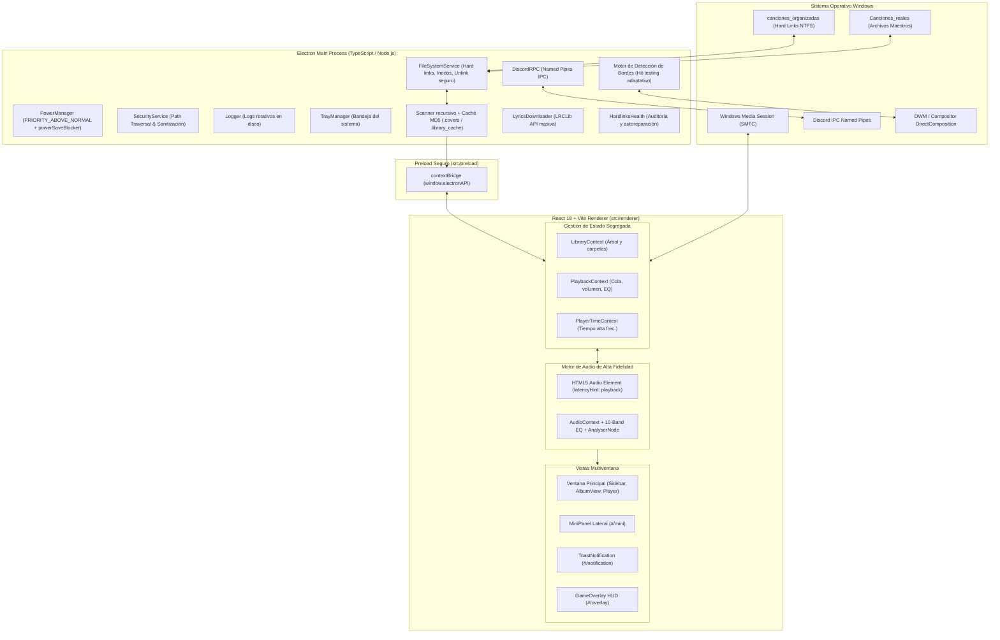

# 🎵 Reproductor de Música Personal (Desktop App)

Aplicación de escritorio moderna, ultra-optimizada y de baja latencia para reproducir, organizar y gestionar bibliotecas musicales locales sin conexión en **Windows 10/11**. Construida con **Electron**, **React 18**, **TypeScript**, **Vite**, **Web Audio API** y **music-metadata**.

---

## 📑 Tabla de Contenidos
1. [Visión General y Propósito](#-visión-general-y-propósito)
2. [Arquitectura General del Sistema](#-arquitectura-general-del-sistema)
3. [Estructura del Proyecto](#-estructura-del-proyecto)
4. [Módulos y Servicios del Núcleo](#-módulos-y-servicios-del-núcleo)
   - [4.1. Servicios Backend (TypeScript / Electron Main)](#41-servicios-backend-typescript--electron-main)
   - [4.2. Motor de Escaneo, Metadatos y Hard Links NTFS](#42-motor-de-escaneo-metadatos-y-hard-links-ntfs)
   - [4.3. Ventanas Especializadas y Detección de Bordes](#43-ventanas-especializadas-y-detección-de-bordes)
   - [4.4. Frontend React, Estado y Rendimiento](#44-frontend-react-estado-y-rendimiento)
   - [4.5. Motor de Audio, Ecualizador y Visualizador Espectral](#45-motor-de-audio-ecualizador-y-visualizador-espectral)
5. [Características Destacadas](#-características-destacadas)
6. [Atajos de Teclado y Control Global](#-atajos-de-teclado-y-control-global)
7. [Suite de Pruebas Automatizadas](#-suite-de-pruebas-automatizadas)
8. [Instalación y Comandos de Compilación](#-instalación-y-comandos-de-compilación)

---

## 🌟 Visión General y Propósito

El **Reproductor de Música Personal** fue concebido para superar las deficiencias habituales de reproductores pesados basados en Chromium y servicios de streaming:
- **Cero latencia y cero micro-cortes**: Blindado contra el estrangulamiento de segundo plano de Windows (*EcoQoS / Efficiency Mode*) y priorizado para ejecutarse en segundo plano mientras juegas a títulos competitivos exigentes (*League of Legends*, shooters, etc.) sin caídas de FPS ni *stuttering* de audio.
- **Acceso instantáneo con múltiples interfaces**: Mini panel lateral flotante con hit-testing por píxel, Game Overlay HUD para videojuegos, notificaciones transparentes y ventana principal completa.
- **Arquitectura de Enlaces Duros NTFS (Hard Links)**: Almacena los archivos maestros en `Canciones_reales/` y los organiza en múltiples carpetas y álbumes dentro de `canciones_organizadas/` ocupando **0 bytes adicionales** en disco y sincronizando inodos automáticamente.
- **Ecualizador paramétrico de 10 bandas y analizador visual**: Procesamiento de hardware en tiempo real con Web Audio API y renderizado en Canvas con física de gravedad para picos espectrales.
- **Letras sincronizadas (LRC)**: Soporte completo de letras karaoke sincronizadas con desplazamiento suave, modo temporal en memoria y descarga masiva desde la API de LRCLib.
- **Discord Rich Presence nativo**: Conexión directa mediante Windows Named Pipes (`\\?\pipe\discord-ipc-*`) sin librerías externas en C++.

---

## 🏗️ Arquitectura General del Sistema



---

## 📂 Estructura del Proyecto

```text
Reproductor_de_musica/
├── Aplicacion_Compilada/          # Distribución final para el usuario (instalador y portable)
│   ├── Instalador/                 # Instalador asistido NSIS de Windows (.exe)
│   ├── Version_Portable/           # Versión ejecutable autónoma sin instalación (.exe)
│   └── Iniciar Reproductor.lnk    # Acceso directo preconfigurado
├── canciones_organizadas/          # Biblioteca musical local organizada por álbumes
│   ├── .covers/                    # Caché de carátulas deduplicadas por hash MD5
│   ├── .library_cache.json         # Caché de metadatos validada por mtimeMs
│   └── .song_albums_index.json     # Índice relacional inodo-álbumes
├── scripts/                        # Scripts PowerShell de automatización
│   ├── update_compiled_app.ps1     # Empaquetado y sincronización con Aplicacion_Compilada/
│   ├── create_shortcut.ps1         # Creación de accesos directos en el Escritorio
│   └── generate_icon.ps1           # Generador de archivos .ico multirresolución
├── src/
│   ├── main/                       # Proceso Principal de Electron (Node.js & TypeScript)
│   │   ├── services/               # Servicios desacoplados de infraestructura (TypeScript)
│   │   │   ├── FileSystemService.ts # Enlaces duros NTFS, reintentos exponenciales, inodos
│   │   │   ├── SecurityService.ts   # Sanitización de rutas y nombres, bloqueo de Path Traversal
│   │   │   ├── PowerManager.ts      # Boost de prioridad (CPU) y prevención de suspensión
│   │   │   ├── Logger.ts            # Sistema de logging rotativo en disco
│   │   │   └── TrayManager.ts       # Menú contextual y gestión de bandeja del sistema
│   │   ├── index.js                # Orquestador del ciclo de vida, ventanas e IPC
│   │   ├── scanner.js              # Escaneo asíncrono limitado, caché y extracción de tags
│   │   ├── hotkeys.js              # Registro y despacho de atajos globales
│   │   ├── discordRpc.js           # Rich Presence sobre Named Pipes sin módulos C++
│   │   ├── lyricsDownloader.js     # Cliente LRCLib para descarga masiva de letras
│   │   └── hardlinksHealth.js      # Auditoría de salud y auto-reparación de inodos
│   ├── preload/                    # Puente Seguro IPC
│   │   └── index.js                # contextBridge con API tipada e inmutable
│   ├── shared/                     # Módulos de dominio compartidos y tipados (TypeScript)
│   │   ├── types.ts                # Definiciones de Track, Album, PlayerState, etc.
│   │   ├── lyricsParser.ts         # Parser de letras LRC y marcas de tiempo
│   │   └── shuffle.ts              # Algoritmo Fisher-Yates sin repetición cíclica
│   └── renderer/                   # Proceso de Renderizado (React 18 + Vite)
│       ├── index.html              # Shell HTML con script Zero-FOUC
│       └── src/
│           ├── main.jsx            # Punto de montaje React
│           ├── App.jsx             # Ruteo (#/mini, #/notification, #/overlay) y Suspense
│           ├── App.css             # Estilos completos con soporte para tema Dark y Light
│           ├── context/
│           │   └── PlayerContext.jsx # Estado global dividido, Web Audio API y EQ
│           ├── components/
│           │   ├── Sidebar.jsx          # Explorador de biblioteca, Drag & Drop y modales
│           │   ├── AlbumView.jsx        # Vista de álbum virtualizada con marcadores
│           │   ├── Player.jsx           # Controles inferiores, scrubbing y EQ
│           │   ├── MiniPanel.jsx        # Panel lateral rápido flotante
│           │   ├── GameOverlay.jsx      # HUD flotante para juegos con rueda de volumen
│           │   ├── LyricsDock.jsx       # Dock de letras sincronizadas con karaoke
│           │   ├── AudioVisualizer.jsx  # Analizador de espectro FFT en Canvas
│           │   ├── SpotlightSearch.jsx  # Buscador global rápido (Ctrl+K / Ctrl+F)
│           │   ├── SettingsModal.jsx    # Modal de configuración de 6 secciones
│           │   ├── ExtractorModal.jsx   # Lanzador de extracción con auto-pegado
│           │   ├── ErrorBoundary.jsx    # Aislamiento reactivo ante errores de interfaz
│           │   └── ToastNotification.jsx# Notificación flotante de pista actual
│           └── utils/
│               └── trackUtils.js        # Utilidades de claves canónicas y portadas
├── test/                           # Suite de Pruebas Automatizadas (Vitest)
│   ├── lyrics.test.ts              # Pruebas de parseo LRC, tiempos y formato
│   ├── security.test.ts            # Pruebas de sanitización y prevención de Path Traversal
│   └── shuffle.test.ts             # Pruebas estadísticas de aleatoriedad Fisher-Yates
├── electron.vite.config.mjs         # Configuración Vite para Main, Preload y Renderer
├── vitest.config.ts                # Configuración del ejecutor de pruebas Vitest
├── tsconfig.json                   # Configuración del compilador TypeScript
└── package.json                    # Scripts npm, dependencias y metadatos de compilación
```

---

## ⚙️ Módulos y Servicios del Núcleo

### 4.1. Servicios Backend (TypeScript / Electron Main)

- **`PowerManager.ts`**: Eleva la prioridad del proceso principal y del proceso de renderizado (PID de audio) a `PRIORITY_ABOVE_NORMAL`. Controla el `powerSaveBlocker` para evitar que Windows active el modo de bajo consumo (*EcoQoS*) mientras haya audio sonando.
- **`SecurityService.ts`**: Valida que cualquier ruta solicitada resida estrictamente dentro de las raíces autorizadas (`canciones_organizadas` o `Canciones_reales`), evitando ataques de *Path Traversal*. Sanitiza nombres prohibidos en Windows (`CON`, `PRN`, `AUX`, etc.) y caracteres ilegales (`\/:*?"<>|`).
- **`FileSystemService.ts`**: Centraliza operaciones de disco sobre enlaces duros NTFS. Implementa `unlinkWithRetry` con retroceso exponencial ante bloqueos transitorios por antivirus o indexadores de Windows, y `findRealMusicFilesByInode` para resolver la relación física 1 a N de cada canción.
- **`Logger.ts`**: Registro asíncrono con cola en memoria y volcado por lotes a archivos rotativos de 5 MB en `userData/logs/app.log`.
- **`TrayManager.ts`**: Control de la bandeja del sistema con menús dinámicos que muestran el título truncado, reproducción, pausa, salto de pista y restauración inmediata de la ventana.

### 4.2. Motor de Escaneo, Metadatos y Hard Links NTFS

- **Identidad Canónica por Inodo (`computeTrackUniqueKey`)**: Cada archivo se identifica primariamente por su inodo de 64 bits (`ino:<stats.ino>`). Esto garantiza que dos enlaces duros en carpetas diferentes se reconozcan como la misma canción física.
- **Eliminación Segura (`unlinkHardLinkAndCleanupMaster`)**: Al borrar una canción de un álbum, se ejecuta `unlink` solo sobre ese enlace duro. El archivo físico maestro en `Canciones_reales` **únicamente** se destruye si se ha eliminado el último enlace duro activo en la biblioteca.
- **Caché en Disco de Dos Niveles**:
  - `.library_cache.json`: Almacena rutas, `mtimeMs` y metadatos completos para arranques en frío en menos de 100 ms.
  - `.covers/[hash].jpg`: Deduplica imágenes incrustadas mediante hash MD5, ahorrando memoria y almacenamiento.
- **Auditoría de Salud (`hardlinksHealth.js`)**: Diagnostica enlaces huérfanos, pistas con divergencias de inodo y permite la sincronización y reparación automática desde la pestaña *Hard Links* en Ajustes.

### 4.3. Ventanas Especializadas y Detección de Bordes

- **Switches de Chromium**:
  ```javascript
  app.commandLine.appendSwitch('disable-renderer-backgrounding')
  app.commandLine.appendSwitch('disable-background-timer-throttling')
  app.commandLine.appendSwitch('disable-backgrounding-occluded-windows')
  app.commandLine.appendSwitch('autoplay-policy', 'no-user-gesture-required')
  ```
- **Capas Z diferenciadas (Always-on-Top)**:
  - `mainWindow`: `'pop-up-menu'`
  - `notificationWindow`: `'screen-saver'` (Nivel 1)
  - `sidePanel`: `'screen-saver'` (Nivel 2)
  - `overlayWindow`: `'screen-saver'` (Nivel 1)
- **MiniPanel Lateral Adaptativo**: Precalentado con DirectComposition mediante `showInactive()`, con hit-testing por píxel (`setIgnoreMouseEvents`) para no bloquear clics en videojuegos o aplicaciones subyacentes.

### 4.4. Frontend React, Estado y Rendimiento

- **Segregación de Contextos**:
  - `LibraryContext`: Administra el árbol de álbumes y carpetas (solo re-renderiza ante cambios estructurales).
  - `PlaybackContext`: Administra la pista actual, cola, volumen y estado de pausa.
  - `PlayerTimeContext`: Gestiona el progreso en milisegundos a alta frecuencia sin provocar re-renderizados en el árbol de álbumes ni en la barra lateral.
- **Arranque Zero-FOUC y Code Splitting**: Script en `<head>` de `index.html` aplica estilos y tema de forma síncrona antes de la carga de React. Los componentes pesados se cargan de forma diferida mediante `React.lazy` y `Suspense`.
- **Virtualización de AlbumView**: Renderizado de listas con cálculo dinámico mediante `ResizeObserver` y *throttling* con `requestAnimationFrame` para desplazar miles de canciones a 60/144 FPS sin caídas de cuadros.

### 4.5. Motor de Audio, Ecualizador y Visualizador Espectral

- **Cadena Web Audio API**:
  - Elemento HTML5 `<audio>` configurado con `latencyHint: 'playback'` para maximizar la estabilidad del búfer.
  - Cadena de 10 filtros `BiquadFilterNode` (lowshelf en 60 Hz, 8 bandas peaking entre 170 Hz y 14 kHz, y highshelf en 16 kHz) con rampas suaves de 20 ms para evitar *clicks* acústicos.
  - `AnalyserNode` con `fftSize = 128` (64 bandas utilizables) y suavizado de 0.60 para animar el espectro en Canvas con aceleración gravitatoria de picos.
- **Resiliencia de Audio**: Auto-recuperación ante errores de decodificación o interrupciones, e ignorado inteligente de `MEDIA_ERR_ABORTED` en saltos continuos de pista.

---

## 💎 Características Destacadas

1. **Gestor de Carátulas Interactivo**: Botón de engranaje (⚙️) en la cabecera de cada álbum que permite elegir la portada entre las carátulas de las canciones del álbum, persistiendo `cover.jpg` en disco con refresco inmediato.
2. **Sistema de Marcadores (Bookmarks)**: Indicador visual en cada fila que informa en cuántos álbumes está incluida la pista, permitiendo vincularla o desvincularla con casillas de verificación en un clic.
3. **Descarga Masiva de Letras (LRCLib)**: Descarga automática de letras sincronizadas con opción de guardado permanente en disco (`.lrc`) o reproducción temporal en memoria, con indicador reactivo de micrófono verde (`🎤`).
4. **Game Overlay HUD**: Panel flotante semitransparente con arrastre libre, controles de reproducción y rueda de volumen que no roba el foco de juegos a pantalla completa.
5. **Spotlight Search (`Ctrl+K` / `Ctrl+F`)**: Modal de búsqueda instantánea por título, artista o álbum con resaltado interactivo y navegación por teclado.
6. **Integración con Extractor de Audio**: Modal que detecta automáticamente enlaces de YouTube, Spotify o TikTok desde el portapapeles y lanza el descargador externo.

---

## ⌨️ Atajos de Teclado y Control Global

### Atajos Globales de Windows (configurables en Ajustes o en `src/main/hotkeys.js`):
- `Ctrl + Flecha Derecha` / `Ctrl + Alt + Flecha Derecha` / `MediaNextTrack`: Pista siguiente.
- `Ctrl + Flecha Izquierda` / `Ctrl + Alt + Flecha Izquierda` / `MediaPreviousTrack`: Pista anterior.
- `Ctrl + Espacio` / `Ctrl + Shift + Espacio` / `MediaPlayPause`: Reproducir / Pausar.
- `Ctrl + Flecha Arriba` / `Ctrl + Alt + Flecha Arriba`: Subir volumen (+5%).
- `Ctrl + Flecha Abajo` / `Ctrl + Alt + Flecha Abajo`: Bajar volumen (-5%).
- `Ctrl + Shift + M` / `Ctrl + Alt + M`: Mostrar / ocultar el MiniPanel lateral.
- `Ctrl + Shift + R` / `Ctrl + Alt + R`: Restaurar o enfocar la ventana principal.
- `Ctrl + Shift + F` / `Ctrl + Alt + F` / `Ctrl + Shift + T`: Fijar / soltar ventana principal en primer plano.
- `Ctrl + Alt + H` / `Ctrl + Shift + H`: Mostrar / ocultar el Game Overlay HUD.

### Atajos en la Ventana Principal:
- `Espacio`: Reproducir / Pausar.
- `Ctrl + K` o `Ctrl + F`: Abrir Buscador Spotlight.
- `Flecha Arriba` / `Flecha Abajo`: Subir o bajar volumen (+/- 5%).
- `Escape`: Cerrar modales, menús contextuales, Spotlight o panel de letras.

---

## 🧪 Suite de Pruebas Automatizadas

El proyecto cuenta con 17 pruebas unitarias ejecutadas mediante **Vitest**, validando los módulos compartidos de dominio (`src/shared/lyricsParser.ts`, `src/shared/shuffle.ts`) y los servicios de seguridad utilizados directamente en producción:

```bash
# Ejecutar todas las pruebas unitarias
npm test

# Modo observador continuo durante desarrollo
npm run test:watch
```

Cobertura actual:
- **`test/shuffle.test.ts`**: Valida que el algoritmo Fisher-Yates no repita canciones dentro de un mismo ciclo, conserve la totalidad de los elementos y baraje de forma equiprobable.
- **`test/security.test.ts`**: Comprueba la sanitización de nombres de archivo reservados en Windows y la prevención de ataques de Path Traversal hacia directorios del sistema.
- **`test/lyrics.test.ts`**: Verifica el análisis y sincronización de letras LRC (marcas `[mm:ss.xx]`), descarte de metadatos no musicales y orden cronológico.

---

## 💻 Instalación y Comandos de Compilación

### Requisitos Previos
- **Node.js**: Versión 18 o superior.
- **npm**: Gestor de paquetes incluido con Node.js.
- **Sistema Operativo**: Windows 10 u 11 (requerido para soporte de Hard Links NTFS, DirectComposition y SMTC).

### Comandos de Ejecución

```bash
# 1. Instalar dependencias
npm install

# 2. Iniciar en modo desarrollo con Hot-Reloading
npm run dev

# 3. Comprobar tipos TypeScript
npm run typecheck

# 4. Ejecutar suite de pruebas
npm test

# 5. Compilar código para producción
npm run build

# 6. Empaquetar instalador y versión portable (distribución completa)
npm run dist

# 7. Crear acceso directo en el Escritorio
npm run shortcut:desktop

# 8. Generar icono .ico multirresolución
npm run icons:generate
```

> [!NOTE]
> El comando `npm run dist` ejecuta `electron-vite build`, `electron-builder` para Windows (generando instalador NSIS y versión portable de 64 bits) y corre `scripts/update_compiled_app.ps1`, dejando los ejecutables organizados en `Aplicacion_Compilada/`.

---

## 📄 Licencia

Proyecto de reproductor de música personal de alto rendimiento para escritorio. Todos los derechos reservados.
