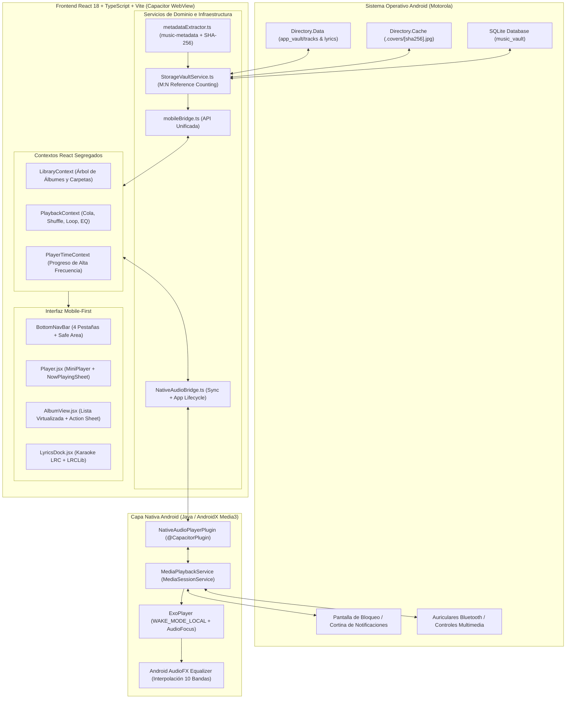

# 📱🎵 Reproductor de Música Personal (Mobile-First Android & Capacitor)

Aplicación móvil nativa para **Android (optimizada para dispositivos Motorola)** y entorno Web moderno, diseñada para reproducir, organizar y gestionar bibliotecas musicales y de video locales sin conexión con **cero duplicación de almacenamiento** y **reproducción continua garantizada con pantalla apagada**.

Construida con **Capacitor 6**, **AndroidX Media3 (ExoPlayer + MediaSessionService)**, **SQLite (`@capacitor-community/sqlite`)**, **React 18**, **TypeScript**, **Vite 5** y **music-metadata**.

---

## 📑 Tabla de Contenidos
1. [Visión General y Arquitectura Mobile-First](#-visión-general-y-arquitectura-mobile-first)
2. [Diagrama de Arquitectura del Sistema](#-diagrama-de-arquitectura-del-sistema)
3. [Estructura del Proyecto](#-estructura-del-proyecto)
4. [Pilares de Ingeniería Móvil](#-pilares-de-ingeniería-móvil)
   - [4.1. Motor Single Physical Store + Virtual Inode Index (SQLite)](#41-motor-single-physical-store--virtual-inode-index-sqlite)
   - [4.2. Servicio Nativo AndroidX Media3 (ExoPlayer + ForegroundService)](#42-servicio-nativo-androidx-media3-exoplayer--foregroundservice)
   - [4.3. Ecualizador Híbrido de 10 Bandas (DSP Hardware + Web Audio)](#43-ecualizador-híbrido-de-10-bandas-dsp-hardware--web-audio)
   - [4.4. Interfaz Táctil Mobile-First y Ergonomía One-Handed](#44-interfaz-táctil-mobile-first-y-ergonomía-one-handed)
5. [Características Principales](#-características-principales)
6. [Suite de Pruebas Automatizadas (Vitest)](#-suite-de-pruebas-automatizadas-vitest)
7. [Guía Paso a Paso: Compilación y Despliegue en Motorola](#-guía-paso-a-paso-compilación-y-despliegue-en-motorola)

---

## 🌟 Visión General y Arquitectura Mobile-First

El **Reproductor de Música Personal** resuelve de raíz las limitaciones de los sistemas de archivos móviles en Android (donde `sdcardfs` / `FUSE` bloquean los enlaces duros `fs.link` de escritorio) y las restricciones agresivas de batería al apagar la pantalla:

- **Bóveda Relacional Sin Duplicación (*Single Physical Store + Virtual Inode Index*)**: Reemplaza los Hard Links NTFS de escritorio por un almacén físico único en `Directory.Data/app_vault/tracks/` indexado mediante una relación muchos-a-muchos (`M:N`) en **SQLite**. Asignar una canción a 10 álbumes distintos ocupa **0 bytes adicionales** en la memoria del teléfono.
- **Reproducción Ininterrumpida con Pantalla Apagada (`AndroidX Media3`)**: Servicio nativo en primer plano (`MediaPlaybackService` con `foregroundServiceType="mediaPlayback"` y `C.WAKE_MODE_LOCAL`) que mantiene el CPU y el decodificador `ExoPlayer` activos aunque bloquees el Motorola o cambies de aplicación.
- **Integración Total con Android SystemUI y Bluetooth**: Controles nativos en la **pantalla de bloqueo**, **cortina de notificaciones** con carátula de alta resolución y respuesta instantánea a botones de **auriculares Bluetooth** (`Play`, `Pause`, `Siguiente`, `Anterior`, `Seek`).
- **UX Táctil Fluida a 60/120 Hz**: Barra de navegación inferior (`BottomNavBar`), `MiniPlayer` flotante sobre la navegación, hoja deslizable a pantalla completa (`NowPlayingSheet`), hojas de acción inferiores (*Bottom Action Sheets*) y respuesta háptica nativa (`@capacitor/haptics`).

---

## 🏗️ Diagrama de Arquitectura del Sistema



---

## 📂 Estructura del Proyecto

```text
Reproductor_de_musica_para_celu/
├── android/                        # Proyecto nativo Android generado y configurado con Capacitor
│   ├── app/
│   │   ├── build.gradle            # Dependencias AndroidX Media3 (ExoPlayer, Session, UI)
│   │   └── src/main/
│   │       ├── AndroidManifest.xml # Permisos Media Playback, WakeLock y MediaPlaybackService
│   │       └── java/com/reproductor/musica/
│   │           ├── MainActivity.java             # Registro de NativeAudioPlayerPlugin
│   │           ├── MediaPlaybackService.java     # Servicio MediaSessionService + ExoPlayer + EQ
│   │           └── NativeAudioPlayerPlugin.java  # Puente Capacitor JS <-> Media3
│   └── variables.gradle            # SDK Versions (minSdk 22, compileSdk 34, targetSdk 34)
├── src/
│   ├── shared/                     # Módulos compartidos y tipados (TypeScript puro)
│   │   ├── types.ts                # Contratos de Track, Album, PlayerState y Settings
│   │   ├── security.ts             # Sanitización multiplataforma y bloqueo de Path Traversal
│   │   ├── lyricsParser.ts         # Parser de letras sincronizadas LRC ([mm:ss.xx])
│   │   └── shuffle.ts              # Algoritmo Fisher-Yates sin repetición cíclica
│   └── renderer/                   # Aplicación Frontend React 18 + Vite
│       ├── index.html              # Viewport móvil (viewport-fit=cover) y arranque Zero-FOUC
│       └── src/
│           ├── main.jsx            # Inicialización de mobileBridge y montaje de React
│           ├── App.jsx             # Layout móvil con BottomNavBar, vistas y modales
│           ├── App.css             # Sistema de diseño táctil, safe-areas y animaciones
│           ├── services/
│           │   ├── StorageVaultService.ts # Motor SQLite M:N + conteo de referencias + Filesystem
│           │   ├── metadataExtractor.ts   # Extracción de tags ID3/MP4/FLAC y hash SHA-256
│           │   ├── NativeAudioBridge.ts   # Sincronización con NativeAudioPlayer y @capacitor/app
│           │   └── mobileBridge.ts        # Adaptador completo de biblioteca, letras y bóveda
│           ├── context/
│           │   └── PlayerContext.jsx      # Orquestador de reproducción, cola, letras y EQ
│           └── components/
│               ├── BottomNavBar.jsx       # Navegación inferior táctil (Biblioteca, Álbum, Buscar, Ajustes)
│               ├── Player.jsx             # MiniPlayer flotante + NowPlayingSheet a pantalla completa
│               ├── AlbumView.jsx          # Vista de álbum virtualizada con Bottom Action Sheet
│               ├── Sidebar.jsx            # Explorador jerárquico de álbumes y carpetas + importador
│               ├── LyricsDock.jsx         # Visor karaoke sincronizado y búsqueda en LRCLib
│               ├── AudioVisualizer.jsx    # Analizador espectral en Canvas a 60 FPS
│               ├── SpotlightSearch.jsx    # Buscador instantáneo de canciones y álbumes
│               ├── SettingsModal.jsx      # Ajustes móviles (Audio, Letras, Apariencia, Bóveda)
│               └── ErrorBoundary.jsx      # Aislamiento resiliente ante errores de renderizado
├── test/                           # Suite de pruebas unitarias e integración (Vitest)
│   ├── vault.test.ts               # Pruebas de conteo de referencias M:N y limpieza física
│   ├── lyrics.test.ts              # Pruebas de sincronización y parseo LRC
│   ├── security.test.ts            # Pruebas de sanitización y seguridad de rutas
│   └── shuffle.test.ts             # Pruebas estadísticas de aleatoriedad Fisher-Yates
├── capacitor.config.ts             # Configuración de Capacitor (com.reproductor.musica)
├── vite.config.ts                  # Configuración de compilación Web pura hacia dist-web/
├── vitest.config.ts                # Configuración del runner de pruebas Vitest
├── tsconfig.json                   # Configuración estricta de TypeScript
└── package.json                    # Scripts y dependencias de Capacitor y React
```

---

## ⚙️ Pilares de Ingeniería Móvil

### 4.1. Motor Single Physical Store + Virtual Inode Index (SQLite)

- **Esquema Relacional (`StorageVaultService.ts`)**:
  - `tracks`: Almacena cada pista única (`id`, `file_path`, `title`, `artist`, `duration`, `cover_hash`, `has_lrc`, `media_type`, `size_bytes`).
  - `albums`: Soporta tanto álbumes como carpetas anidadas (`id`, `name`, `parent_id`, `node_type`, `custom_cover`).
  - `album_tracks`: Tabla pivote (`album_id`, `track_id`, `track_order`) que permite que una misma canción pertenezca a múltiples álbumes sin duplicar el archivo físico.
- **Recolección de Basura por Conteo de Referencias**:
  - **Desvincular de un álbum**: Elimina únicamente la fila en `album_tracks`. Si `COUNT(*) > 0` en otros álbumes, el archivo maestro en `app_vault/tracks/` permanece intacto.
  - **Eliminación del último vínculo**: Cuando `COUNT(*) == 0`, se elimina automáticamente el registro en `tracks`, el archivo físico de audio/video en `Directory.Data` y su archivo `.lrc` asociado.

### 4.2. Servicio Nativo AndroidX Media3 (`ExoPlayer` + `ForegroundService`)

- **`MediaPlaybackService.java`**:
  - Extiende `MediaSessionService` con `foregroundServiceType="mediaPlayback"`.
  - Configura `ExoPlayer` con `C.USAGE_MEDIA`, `C.AUDIO_CONTENT_TYPE_MUSIC`, gestión automática de `AudioFocus` (`setHandleAudioBecomingNoisy(true)` al desconectar auriculares) y `C.WAKE_MODE_LOCAL` para impedir que el procesador del Motorola entre en suspensión profunda durante la reproducción.
  - Envuelve `ExoPlayer` en un `ForwardingPlayer` que habilita permanentemente los comandos `COMMAND_SEEK_TO_NEXT`, `COMMAND_SEEK_TO_PREVIOUS`, `COMMAND_PLAY_PAUSE` y `COMMAND_SEEK_IN_CURRENT_MEDIA_ITEM` en la pantalla de bloqueo y notificación multimedia.
  - Embebe los bytes de la portada (`setArtworkData`) directamente en `MediaMetadata` para que `SystemUI` de Android muestre la carátula en la pantalla de bloqueo sin restricciones de permisos del directorio privado de caché.

### 4.3. Ecualizador Híbrido de 10 Bandas (DSP Hardware + Web Audio)

- Las 10 bandas configurables en la interfaz (`60Hz, 170Hz, 310Hz, 600Hz, 1kHz, 3kHz, 6kHz, 12kHz, 14kHz, 16kHz`) y sus presets (*Plano, Bass Boost, Rock, Pop, Vocal, Club / Dance, Agudos*) se sincronizan en tiempo real con `android.media.audiofx.Equalizer` vinculado al `audioSessionId` de `ExoPlayer`, interpolando logarítmicamente las ganancias en decibelios a las bandas físicas del DSP del dispositivo Motorola.

### 4.4. Interfaz Táctil Mobile-First y Ergonomía One-Handed

- **Navegación Inferior (`BottomNavBar.jsx`)**: Acceso con el pulgar a *Biblioteca*, *Álbum Actual*, *Buscar* y *Ajustes*, con retroalimentación háptica sutil.
- **Reproductor Dual (`Player.jsx`)**:
  - **MiniPlayer Flotante**: Píldora compacta sobre la barra inferior con barra de progreso superior, portada, título en marquesina, botón Play/Pause y botón Siguiente.
  - **NowPlayingSheet**: Hoja a pantalla completa con gesto *swipe-down* para minimizar, carátula grande (o `<video>` sincronizado para pistas MP4/WebM), controles de gran tamaño (`68x68px`), letras sincronizadas integradas y modal de ecualizador.
- **Action Sheets Táctiles (`AlbumView.jsx`)**: Menú contextual inferior por canción (`⋯`) para gestionar en qué álbumes está marcada la pista (*Bookmarks M:N*) o eliminarla del álbum actual con confirmación clara de referencias restantes.

---

## 🧪 Suite de Pruebas Automatizadas (Vitest)

El proyecto incluye **23 pruebas automatizadas** en 4 suites que verifican la lógica de dominio, seguridad y el motor relacional de la bóveda:

```bash
# Ejecutar todas las pruebas unitarias y de bóveda relacional
npm test

# Comprobar tipos de TypeScript en todo el proyecto
npm run typecheck
```

- **`test/vault.test.ts`**: Verifica importación en la bóveda, asignación `M:N` a múltiples álbumes sin duplicar el archivo físico, preservación del archivo maestro al borrarlo de un solo álbum (`remainingReferences > 0`), borrado físico automático al eliminar la última referencia (`remainingReferences === 0`) y auditoría/compactación de salud de la bóveda.
- **`test/lyrics.test.ts`**: Verifica el parser de letras sincronizadas LRC.
- **`test/security.test.ts`**: Verifica la sanitización de nombres y bloqueo de Path Traversal.
- **`test/shuffle.test.ts`**: Verifica el barajado Fisher-Yates sin repetición cíclica.

---

## 🚀 Guía Paso a Paso: Compilación y Despliegue en Motorola

### Requisitos Previos
- **Node.js** 18+ y **npm**.
- **Android Studio** (Iguana / Jellyfish / Koala o superior) con **Android SDK Platform 34** y **JDK 17+**.
- En tu **Motorola**: Activar *Opciones de desarrollador* y habilitar **Depuración por USB**.

### Comandos Principales

```bash
# 1. Instalar dependencias del proyecto
npm install

# 2. Ejecutar en modo desarrollo Web (vista previa rápida en navegador)
npm run dev

# 3. Compilar la aplicación Web y sincronizar assets + plugins con Android
npm run cap:sync

# 4. Abrir el proyecto nativo en Android Studio para compilar APK o depurar en el Motorola
npm run cap:open

# 5. Compilar y ejecutar directamente en el Motorola conectado por USB
npm run android:run
```

### Flujo en Android Studio para instalar en el Motorola
1. Ejecuta `npm run cap:sync` y luego `npm run cap:open`.
2. Conecta tu teléfono **Motorola** por cable USB (o mediante *Wireless Debugging*) y acepta la huella RSA de depuración en la pantalla del teléfono.
3. En la barra superior de Android Studio, selecciona tu dispositivo **Motorola** y pulsa el botón verde **Run ('app')** (`Shift + F10`), o genera el instalador desde **Build > Build Bundle(s) / APK(s) > Build APK(s)**.
4. Al abrir la app en el Motorola, acepta el permiso de notificaciones para visualizar los controles multimedia en la pantalla de bloqueo y cortina de notificaciones.
