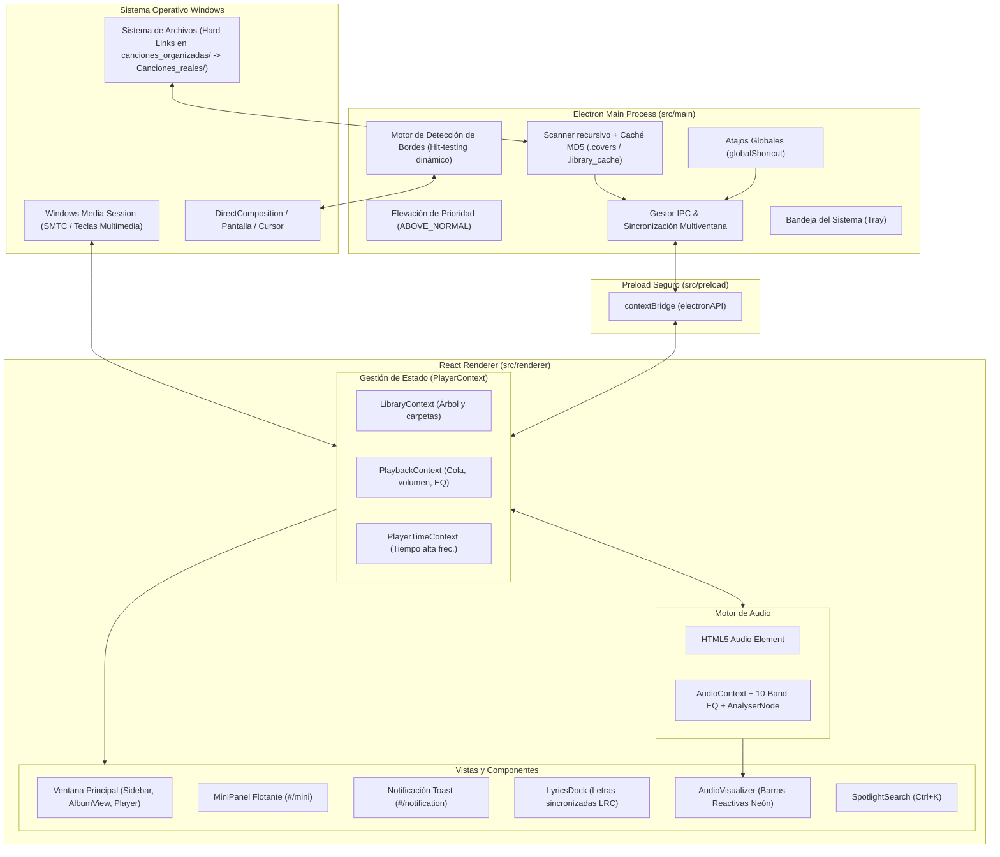

# 🎵 Reproductor de Música Personal (Desktop App)

Aplicación de escritorio moderna, minimalista y de alto rendimiento diseñada para reproducir, organizar y gestionar bibliotecas musicales locales sin conexión. Construida con **Electron**, **React 18**, **Vite**, **Web Audio API** y **music-metadata**.

---

## 📑 Tabla de Contenidos
1. [Visión General y Propósito del Proyecto](#-visión-general-y-propósito-del-proyecto)
2. [Arquitectura General del Sistema](#-arquitectura-general-del-sistema)
3. [Resumen Detallado de Procesos y su Finalidad](#-resumen-detallado-de-procesos-y-su-finalidad)
   - [3.1. Procesos del Núcleo Electron (Main Process)](#31-procesos-del-núcleo-electron-main-process)
   - [3.2. Motor de Escaneo, Metadatos y Caché en Disco](#32-motor-de-escaneo-metadatos-y-caché-en-disco)
   - [3.3. Detección Adaptativa de Bordes y Panel Lateral Flotante](#33-detección-adaptativa-de-bordes-y-panel-lateral-flotante)
   - [3.4. Procesos del Preload y Context Bridge Seguro](#34-procesos-del-preload-y-context-bridge-seguro)
   - [3.5. Procesos de Renderizado y Estado (React Renderer)](#35-procesos-de-renderizado-y-estado-react-renderer)
   - [3.6. Motor de Audio, Ecualizador y Análisis Espectral](#36-motor-de-audio-ecualizador-y-análisis-espectral)
   - [3.7. Interfaz, Componentes y Experiencia de Usuario](#37-interfaz-componentes-y-experiencia-de-usuario)
   - [3.8. Procesos de Empaquetado y Distribución](#38-procesos-de-empaquetado-y-distribución)
4. [Estructura del Repositorio](#-estructura-del-repositorio)
5. [Guía de Uso y Atajos de Teclado](#-guía-de-uso-y-atajos-de-teclado)
6. [Instalación y Comandos de Desarrollo](#-instalación-y-comandos-de-desarrollo)

---

## 🌟 Visión General y Propósito del Proyecto

El **Reproductor de Música Personal** surge para resolver las limitaciones de los reproductores convencionales:
- **Cero latencia y cero consumo ocioso**: Diseñado para funcionar en segundo plano mientras juegas a títulos exigentes (ej. *League of Legends*) sin causar tirones (*stuttering*) de FPS ni distorsiones de audio.
- **Acceso instantáneo sin minimizar tus juegos**: Un mini panel lateral transparente que asoma con solo acercar el ratón al margen de la pantalla o mediante atajos globales.
- **Organización directa y real en el disco**: Cada cambio realizado en la interfaz (mover álbumes, crear carpetas, renombrar o editar etiquetas) se refleja físicamente en las carpetas de tu sistema de archivos de Windows de forma segura.
- **Fidelidad y personalización sonora**: Ecualizador paramétrico de 10 bandas y analizador de espectro de alta frecuencia procesado en hardware mediante Web Audio API.

---

## 🏗️ Arquitectura General del Sistema



---

## 🔍 Resumen Detallado de Procesos y su Finalidad

A continuación se detalla exhaustivamente cada uno de los procesos del sistema, su funcionamiento técnico y el objetivo para el cual fue implementado:

### 3.1. Procesos del Núcleo Electron (Main Process)

| Proceso | Archivo Fuente | Funcionamiento Técnico | Finalidad y Beneficio |
| :--- | :--- | :--- | :--- |
| **Elevación de Prioridad de Proceso** | `src/main/index.js` | Invoca `os.setPriority(PRIORITY_ABOVE_NORMAL)` durante `app.whenReady()`. | Asegura que Windows otorgue ciclos de CPU preferentes al reproductor, evitando cortes de audio (*buffer underruns*) cuando se ejecutan videojuegos de alto consumo o tareas de renderizado pesado. |
| **Desactivación de Estrangulamiento en Segundo Plano** | `src/main/index.js` | Establece `backgroundThrottling: false` en las tres ventanas del sistema (`mainWindow`, `sidePanel`, `notificationWindow`). | Impide que el motor Chromium reduzca los timers de JavaScript a 1 Hz o congele el render cuando la aplicación no está en foco. Garantiza que la música y las transiciones no se interrumpan. |
| **Gestión de Jerarquía Z (Always-on-Top en Capas)** | `src/main/index.js` | Configura niveles Z diferenciados: `mainWindow` en `'pop-up-menu'`, `notificationWindow` en `'screen-saver'` nivel 1, y `sidePanel` en `'screen-saver'` nivel 2. | Garantiza un orden de superposición estricto: el mini panel rápido siempre se dibuja por encima de juegos en pantalla completa y de los avisos flotantes, sin que las ventanas compitan ni se tapen indebidamente. |
| **Minimizado Coordinado con Despliegue Anticipado** | `src/main/index.js` | Intercepta `window-minimize`, abre el panel lateral en modo `expanded` antes de ejecutar `mainWindow.minimize()` con un retardo de 16 ms y gracia de foco de 650 ms. | Proporciona una transición fluida al usuario: al minimizar la ventana principal, el mini panel lateral ya se encuentra visible en el lateral de la pantalla sin pantallas negras ni retrasos causados por el DWM de Windows. |
| **Bandeja del Sistema (System Tray)** | `src/main/index.js` | Inicializa un objeto `Tray` con menú contextual que muestra título truncado, controles de reproducción (`toggle-play`, `next`, `previous`), restauración y salida. | Permite controlar el reproductor o cerrarlo completamente aun si la ventana principal ha sido cerrada o minimizada. |
| **Observador en Caliente de la Biblioteca (Folder Watcher)** | `src/main/index.js` | Ejecuta `fs.watch(dir, { recursive: true })` con un temporizador de *debounce* de 1500 ms. | Detecta cuando el usuario añade, renombra o borra canciones desde el Explorador de Windows o descargas del navegador, re-escaneando y actualizando la interfaz automáticamente sin requerir reinicios. |

---

### 3.2. Motor de Escaneo, Metadatos y Caché en Disco

| Proceso | Archivo Fuente | Funcionamiento Técnico | Finalidad y Beneficio |
| :--- | :--- | :--- | :--- |
| **Escaneo Jerárquico Asíncrono** | `src/main/scanner.js` | Recorre recursivamente las carpetas usando `fs.promises.readdir` y clasifica cada directorio: si tiene subdirectorios es `'folder'`, si contiene archivos de audio directos es `'album'`. | Respeta la estructura de carpetas real del usuario, admitiendo categorías anidadas y álbumes directos de forma intuitiva. |
| **Concurrencia Acotada de I/O** | `src/main/scanner.js` | Utiliza un despachador `createLimiter`: máximo 8 carpetas en paralelo y 16 archivos de metadatos en paralelo. | Evita saturar el bus del disco y previene errores del sistema operativo por agotamiento de descriptores de archivo (`EMFILE`). |
| **Caché Persistente por `mtime`** | `src/main/scanner.js` | Guarda `.library_cache.json` asociando la ruta, el tamaño y la fecha de última modificación (`mtimeMs`). Si no cambió, lee la caché en memoria en 0 ms. | Permite que bibliotecas de más de 10.000 canciones carguen instantáneamente en menos de 100 ms tras el primer escaneo. |
| **Deduplicación de Carátulas por MD5** | `src/main/scanner.js` | Extrae el *buffer* de imagen con `music-metadata`, genera un hash MD5 y guarda el archivo en `.covers/[hash].jpg/png`. Mantiene un `Set` en memoria de carátulas conocidas. | Evita almacenar miles de imágenes duplicadas en disco y reduce drásticamente el consumo de memoria RAM al reutilizar URLs locales (`file://`). |
| **Cálculo de Identidad Canónica por Inodo (`computeTrackUniqueKey`)** | `src/main/scanner.js` | Identifica primero el inodo NTFS (`ino:<stats.ino>`) mediante `fs.promises.stat(path, { bigint: true })` y respalda con `titulo|artista|duracion`. | Detecta con 100% de exactitud si varios enlaces duros apuntan al mismo archivo real en `Canciones_reales`, habilitando el sistema de marcadores (*bookmarks*). |
| **Indexación Relacional de Canciones** | `src/main/scanner.js` | `annotateSongAlbumsModel` recorre el árbol y construye un mapa de qué álbumes contienen cada enlace duro de la canción, persistiendo `.song_albums_index.json`. | Facilita saber en qué álbumes está enlazada una pista y gestionar sus Hard Links con rendimiento $O(1)$. |
| **Extracción y Parseo de Letras (LRC / ID3)** | `src/main/scanner.js` / `src/main/index.js` | Busca archivos externos `.lrc` / `.txt` tanto en la carpeta del álbum como en `C:\Users\barre\Music\Canciones_reales`; si no existen, inspecciona marcos ID3 (`SYLT` y `USLT`) en MP3 y etiquetas de `music-metadata` en FLAC/M4A/OGG. | Extrae letras sincronizadas `[mm:ss.xx]` o en texto plano sin necesidad de enlazar los archivos `.lrc` en cada álbum. |
| **Edición ID3 Directa en Disco (Deduplicada por Inodo)** | `src/main/index.js` | Usa `node-id3` para escribir etiquetas `title`, `artist`, `album` *in-place* una sola vez por inodo NTFS (`stats.ino`) e invalida la caché de todas las rutas enlazadas. | Actualiza simultáneamente el archivo maestro en `Canciones_reales` y todos sus Hard Links en `canciones_organizadas` sin romper el vínculo. |
| **Gestión de Enlaces Duros (Hard Links) con `Canciones_reales`** | `src/main/index.js` | - **Asignar a álbum**: crea nuevos enlaces duros con `fs.promises.link` apuntando al mismo inodo.<br>- **Mover / Renombrar**: usa `fs.promises.rename` (y fallback recursivo `fs.link` + `fs.unlink`) para preservar siempre el vínculo.<br>- **Eliminar (`unlinkHardLinkAndCleanupMaster`)**: usa `fs.promises.unlink` para borrar solo el enlace en `canciones_organizadas`, y solo elimina el archivo maestro en `C:\Users\barre\Music\Canciones_reales` (rastreado por `stats.ino`) cuando se borra su último enlace duro activo. | Permite organizar una canción en múltiples álbumes ocupando 0 bytes extra en disco, protegiendo el archivo original en `Canciones_reales` salvo que el usuario elimine su último enlace en la biblioteca. |

---

### 3.3. Detección Adaptativa de Bordes y Panel Lateral Flotante

| Proceso | Archivo Fuente | Funcionamiento Técnico | Finalidad y Beneficio |
| :--- | :--- | :--- | :--- |
| **Pre-calentamiento DirectComposition** | `src/main/index.js` | La ventana `sidePanel` se crea transparente y se muestra con `showInactive()` desde el inicio, con `backgroundThrottling: false`. | Elimina los retrasos visuales (0 ms de latencia) al desplegar la barra lateral, evitando crear y destruir ventanas continuamente. |
| **Hit-Testing por Píxel (`setIgnoreMouseEvents`)** | `src/main/index.js` | Aplica `sidePanel.setIgnoreMouseEvents(true)` sobre las zonas transparentes y `false` solo cuando el cursor toca el marcador o el cajón. | Logra que el usuario pueda hacer clic en el escritorio, ventanas o juegos que estén detrás de la ventana flotante sin interferencias. |
| **Detección Dinámica de Proximidad con Intervalo Adaptativo** | `src/main/index.js` | Evalúa periódicamente la posición del cursor mediante `screen.getCursorScreenPoint()`. El intervalo se ajusta según la distancia: 32 ms cerca del borde, hasta 400 ms si el cursor está lejos. | Ocupa un 0% de uso de CPU en reposo pero reacciona con máxima suavidad cuando el cursor se aproxima al borde derecho. |
| **Corredor de Histéresis contra Parpadeos** | `src/main/index.js` | Define un halo amplio alrededor del marcador cuando ya está visible (hasta 145 px de tolerancia y temporizador de gracia de 210 ms). | Evita que el marcador aparezca y desaparezca erráticamente (*jitter*) cuando el usuario mueve el ratón en diagonal o con movimientos rápidos. |
| **Modos Alternativos: Fijo vs Ocultación Automática** | `src/main/index.js` | Controla los estados `pinned` y `autoHide`. Si está en `autoHide`, el evento `blur` retrae el panel cuando el usuario hace clic fuera de él. | Brinda versatilidad: puedes dejar el panel anclado en pantalla mientras trabajas, o configurarlo para que se oculte solo al terminar de interactuar. |

---

### 3.4. Procesos del Preload y Context Bridge Seguro

| Proceso | Archivo Fuente | Funcionamiento Técnico | Finalidad y Beneficio |
| :--- | :--- | :--- | :--- |
| **Aislamiento de Contexto Seguro** | `src/preload/index.js` | Expone un objeto inmutable `window.electronAPI` a través de `contextBridge.exposeInMainWorld`. | Protege la aplicación contra vulnerabilidades de inyección de código: el proceso Renderer no tiene acceso a módulos nativos de Node.js (`fs`, `child_process`), comunicándose estrictamente mediante IPC tipado. |
| **Envoltura de Eventos Bidireccionales** | `src/preload/index.js` | Los métodos suscriptores (`onLibraryUpdated`, `onPlayerStateSync`, etc.) retornan una función de limpieza que invoca `ipcRenderer.removeListener`. | Previene fugas de memoria (*memory leaks*) en React al desmontar o re-renderizar componentes. |

---

### 3.5. Procesos de Renderizado y Estado (React Renderer)

| Proceso | Archivo Fuente | Funcionamiento Técnico | Finalidad y Beneficio |
| :--- | :--- | :--- | :--- |
| **Segregación de Contextos React** | `src/renderer/src/context/PlayerContext.jsx` | Separa el estado global en cuatro contextos especializados: `LibraryContext`, `PlaybackContext`, `PlayerContext` y `PlayerTimeContext`. | **Optimización de rendimiento crítica**: los componentes pesados como el árbol de álbumes (`Sidebar`) no se vuelven a renderizar cuando el cursor de tiempo de la canción avanza cada 250 ms. Solo los componentes de la línea de tiempo se suscriben a `PlayerTimeContext`. |
| **Colección Virtual Unificada "Todos"** | `src/renderer/src/context/PlayerContext.jsx` | Agrupa todas las canciones de todos los álbumes en un objeto virtual `__all_tracks__`, deduplicando por clave de identidad y asignando una carátula holográfica. | Permite reproducir toda la biblioteca de forma continua en modo aleatorio o buscar pistas sin importar en qué carpeta estén guardadas. |
| **Persistencia de Sesión Completa** | `src/renderer/src/context/PlayerContext.jsx` | Serializa en `localStorage` el álbum seleccionado, la pista actual, el segundo exacto de reproducción, el volumen, el estado de bucle y aleatorio. | Al volver a abrir el programa, la canción y la posición exacta se restauran automáticamente donde las dejaste. |
| **Aleatorio Inteligente Fisher-Yates sin Repetición** | `src/renderer/src/context/PlayerContext.jsx` | Implementa una bolsa barajada mediante el algoritmo Fisher-Yates, rastreando canciones sonadas en un ciclo (`playedInCycleRef`) y evitando que las canciones finales de un ciclo se repitan al inicio del siguiente. | Acaba con la frustración del modo aleatorio simple donde la misma canción puede repetirse varias veces seguidas. |
| **Historial de Reproducción Bidireccional de 200 Pistas** | `src/renderer/src/context/PlayerContext.jsx` | Mantiene pilas independientes `historyRef` y `futureRef`. Presionar "Anterior" retrocede exactamente por las pistas que sonaron antes, y "Siguiente" puede rehacer el camino. | Permite volver a escuchar canciones que sonaron en modo aleatorio sin perder el orden de reproducción. |
| **Sincronización con Windows SMTC y Auriculares** | `src/renderer/src/context/PlayerContext.jsx` | Conecta con `navigator.mediaSession` registrando títulos, artistas, carátula (`sizes: '512x512'`) y escuchando eventos de hardware (`play`, `pause`, `nexttrack`, `previoustrack`, `seekto`). | Permite pausar o cambiar canciones usando los botones físicos o táctiles de auriculares Bluetooth, teclados multimedia o la pantalla de bloqueo de Windows. |
| **Sincronización Multiventana Ligera** | `src/renderer/src/context/PlayerContext.jsx` | Despacha el estado del reproductor vía IPC dividiendo el payload: la lista de reproducción completa solo viaja cuando cambia de referencia; los tiempos viajan en paquetes mínimos de un solo valor numérico. | Mantiene el MiniPanel y la ventana principal en perfecta sintonía sin sobrecargar el bus de IPC ni provocar caídas de frames. |

---

### 3.6. Motor de Audio, Ecualizador y Análisis Espectral

| Proceso | Archivo Fuente | Funcionamiento Técnico | Finalidad y Beneficio |
| :--- | :--- | :--- | :--- |
| **Cadena de Audio en Cascada** | `src/renderer/src/context/PlayerContext.jsx` | Conecta el elemento `<audio>` a `AudioContext.createMediaElementSource()`, encadenando 10 filtros `BiquadFilterNode` seguidos de un `AnalyserNode` hacia `destination`. | Permite alterar el tono y procesar frecuencias de audio en tiempo real antes de que lleguen a los altavoces. |
| **Ecualizador Paramétrico de 10 Bandas** | `src/renderer/src/context/PlayerContext.jsx` | Filtro `lowshelf` en 60 Hz, 8 filtros `peaking` ($Q = 1.4$) entre 170 Hz y 14 kHz, y filtro `highshelf` en 16 kHz. Aplica ganancias mediante `setTargetAtTime` con rampa suave de 20 ms. | Evita chasquidos (*pops/clicks*) al mover los potenciómetros de ganancia o cambiar de preset (Bass Boost, Rock, Pop, etc.). |
| **Análisis de Espectro FFT en Tiempo Real** | `src/renderer/src/components/AudioVisualizer.jsx` | Configura el `AnalyserNode` con `fftSize = 128` (64 bandas de frecuencia útiles), `smoothingTimeConstant = 0.60`, rango de -75 dB a -15 dB. | Extrae la energía acústica de graves, medios y agudos con alta sensibilidad y reactividad rítmica. |
| **Renderizado en Canvas con Física de Picos y Gravedad** | `src/renderer/src/components/AudioVisualizer.jsx` | Dibuja barras con gradiente neón en `<canvas>`. Calcula aceleración por gravedad para los picos flotantes y decaimiento exponencial cuando la música se detiene. | Ofrece una respuesta visual atractiva, suave y estética que acompaña el ritmo de la música. |

---

### 3.7. Interfaz, Componentes y Experiencia de Usuario

| Componente | Archivo Fuente | Procesos y Características | Finalidad |
| :--- | :--- | :--- | :--- |
| **Sidebar (Explorador)** | `src/renderer/src/components/Sidebar.jsx` | - Drag & Drop fluido basado en Pointer Events.<br>- Despliegue automático de carpetas al sobrevolar (500 ms).<br>- Zona de soltado superior (`root-drop-zone`) para sacar álbumes a la raíz.<br>- Menú contextual para mover, renombrar y eliminar con confirmación.<br>- Búsqueda en vivo de carpetas. | Organizar carpetas y álbumes en el disco arrastrando directamente en pantalla o con selectores accesibles. |
| **AlbumView (Lista de Pistas)** | `src/renderer/src/components/AlbumView.jsx` | - Virtualización de lista (`ALBUM_ROW_HEIGHT = 63`, *overscan* de 8 elementos).<br>- Marcadores (*Bookmarks*) interactivos que indican cuántos álbumes contienen la pista.<br>- Selector emergente con casillas para clonar la canción a otros álbumes en 1 clic.<br>- Inspector de propiedades técnicas (bitrate, frecuencia de muestreo, códec, tamaño).<br>- Editor modal de etiquetas ID3. | Permitir navegación fluida en álbumes con cientos de canciones sin congelar el navegador y gestionar duplicados fácilmente. |
| **Player (Controles)** | `src/renderer/src/components/Player.jsx` | - Timeline interactivo con *scrubbing* en tiempo real y previsualización de tiempo al pasar el cursor.<br>- Botón para alternar visualización de tiempo restante/transcurrido.<br>- Cajón desplegable del ecualizador paramétrico con 7 presets y controles deslizantes.<br>- Botón de letras sincronizadas. | Centralizar los controles de reproducción y afinación de audio en una barra inferior moderna. |
| **LyricsDock (Dock de Letras)** | `src/renderer/src/components/LyricsDock.jsx` | - Modo compacto de 3 líneas con efecto de profundidad (verso anterior, actual y siguiente).<br>- Modo expandido con desplazamiento automático al compás de la música.<br>- *Seek-on-click*: hacer clic en cualquier línea salta inmediatamente a ese segundo de la canción. | Disfrutar de letras tipo karaoke sincronizadas o leer la letra completa de cualquier tema. |
| **SpotlightSearch (Buscador)** | `src/renderer/src/components/SpotlightSearch.jsx` | - Buscador modal global accesible mediante `Ctrl+K` o `Ctrl+F`.<br>- Búsqueda combinada por título, artista o nombre de álbum con coincidencias resaltadas.<br>- Navegación por teclado (`Flechas` + `Enter`). | Saltar instantáneamente a cualquier pista de la biblioteca sin buscarla manualmente por las carpetas. |
| **MiniPanel (Panel Lateral)** | `src/renderer/src/components/MiniPanel.jsx` | - Ventana flotante compacta ejecutada bajo la ruta `#/mini`.<br>- Lista de reproducción rápida con selección directa.<br>- Controles de transporte, volumen, aleatorio, bucle y botón para restaurar la ventana principal.<br>- Selector de modo: Anclar (fijo) o Ocultar automáticamente (*auto-hide*). | Controlar la música mientras juegas o trabajas en otras aplicaciones sin ocupar pantalla. |
| **ToastNotification** | `src/renderer/src/components/ToastNotification.jsx` | - Ventana emergente ejecutada bajo la ruta `#/notification`.<br>- Muestra carátula, título y artista durante 3.2 segundos al cambiar de pista.<br>- Totalmente transparente a los clics del ratón (`forward: true`). | Saber qué canción está sonando sin interrumpir tu flujo de trabajo o juego. |

---

### 3.8. Procesos de Empaquetado y Distribución

| Proceso | Archivo / Herramienta | Funcionamiento Técnico | Finalidad |
| :--- | :--- | :--- | :--- |
| **Compilación Dual (Vite + Electron)** | `electron.vite.config.mjs` | Compila el proceso Main y Preload con esbuild/Rollup, y empaqueta la aplicación React en `out/renderer/` con optimización de assets. | Genera código de producción ofuscado, minificado y de alto rendimiento. |
| **Empaquetado de Instalador y Versión Portable** | `electron-builder` (`package.json`) | Genera tanto un instalador asistido NSIS de 64 bits (`.exe`) como una versión portable independiente que no requiere instalación. | Proporcionar opciones de instalación para diferentes necesidades de los usuarios. |
| **Script de Distribución Automatizada** | `scripts/update_compiled_app.ps1` | Toma los binarios generados en `dist/`, los organiza en la carpeta `Aplicacion_Compilada/`, crea accesos directos con iconos dedicados y redacta las instrucciones de uso para el usuario final. | Dejar la aplicación lista para su distribución o copia a un pendrive con un solo comando (`npm run dist`). |

---

## 📂 Estructura del Repositorio

```text
Reproductor_de_musica/
├── Aplicacion_Compilada/          # Ejecutables compilados listos para el usuario final
│   ├── Instalador/                 # Instalador asistido de Windows (.exe)
│   ├── Version_Portable/           # Ejecutable portátil autónomo (.exe)
│   └── Iniciar Reproductor.lnk    # Acceso directo directo
├── canciones_organizadas/          # Carpeta raíz de música local (cada carpeta es un álbum)
│   ├── .covers/                    # Caché interna de carátulas deduplicadas por MD5
│   ├── .library_cache.json         # Índice de metadatos cacheado por mtime
│   └── .song_albums_index.json     # Índice de pertenencia y copias de canciones
├── scripts/                        # Scripts de soporte PowerShell
│   ├── update_compiled_app.ps1     # Automatización de empaquetado y actualización
│   ├── create_shortcut.ps1         # Generador de acceso directo en el Escritorio
│   └── generate_icon.ps1           # Generador de iconos .ico multirresolución
├── src/
│   ├── main/                       # Proceso Principal de Electron
│   │   ├── index.js                # Ventanas, ciclo de vida, IPC, operaciones de disco y tray
│   │   ├── scanner.js              # Escaneo recursivo, concurrencia, metadatos y carátulas
│   │   └── hotkeys.js              # Atajos de teclado globales del sistema
│   ├── preload/                    # Puente Seguro entre Main y Renderer
│   │   └── index.js                # Exposición mediante contextBridge (window.electronAPI)
│   └── renderer/                   # Aplicación de Interfaz de Usuario (React 18)
│       ├── index.html              # Plantilla HTML base
│       └── src/
│           ├── main.jsx            # Punto de montaje React
│           ├── App.jsx             # Shell de la app, enrutamiento (#/mini, #/notification) y barra de título
│           ├── App.css             # Hojas de estilo completas (temas Dark y Light)
│           ├── context/
│           │   └── PlayerContext.jsx # Estado global, Web Audio API, EQ y sincronización IPC
│           ├── components/
│           │   ├── Sidebar.jsx     # Explorador de biblioteca, Drag & Drop y modales
│           │   ├── AlbumView.jsx   # Vista de álbum, tabla virtualizada, bookmarks e ID3
│           │   ├── Player.jsx      # Barra de controles, timeline interactivo y ecualizador
│           │   ├── MiniPanel.jsx   # Panel lateral rápido flotante y configurable
│           │   ├── LyricsDock.jsx  # Dock interactivo de letras sincronizadas (LRC)
│           │   ├── AudioVisualizer.jsx # Analizador espectral en canvas con física de picos
│           │   ├── SpotlightSearch.jsx # Buscador modal global (Ctrl+K)
│           │   └── ToastNotification.jsx # Notificación flotante de pista actual
│           └── utils/
│               └── trackUtils.js   # Utilidades de claves canónicas y portadas por defecto
├── electron.vite.config.mjs         # Configuración Vite para Electron
├── package.json                    # Dependencias, scripts npm y configuración de electron-builder
└── README.md                       # Documentación técnica completa del proyecto
```

---

## ⌨️ Guía de Uso y Atajos de Teclado

### Atajos Globales de Windows (funcionan mientras juegas o estás en otras aplicaciones):
Configurables en `src/main/hotkeys.js`:
- `Ctrl + Flecha Derecha` / `Ctrl + Alt + Flecha Derecha` / `MediaNextTrack`: Siguiente pista.
- `Ctrl + Flecha Izquierda` / `Ctrl + Alt + Flecha Izquierda` / `MediaPreviousTrack`: Pista anterior.
- `Ctrl + Space` / `Ctrl + Shift + Space` / `MediaPlayPause`: Reproducir / Pausar.
- `Ctrl + Flecha Arriba` / `Ctrl + Alt + Flecha Arriba`: Subir volumen (+5%).
- `Ctrl + Flecha Abajo` / `Ctrl + Alt + Flecha Abajo`: Bajar volumen (-5%).
- `Ctrl + Shift + M` / `Ctrl + Alt + M`: Mostrar / ocultar el Panel Lateral Rápido.

### Atajos en la Ventana Principal:
- `Espacio`: Reproducir / Pausar.
- `Ctrl + K` o `Ctrl + F`: Abrir Buscador Global Spotlight.
- `Flecha Arriba` / `Flecha Abajo`: Subir o bajar volumen (+/- 5%).
- `Escape`: Cerrar menús contextuales, ventanas modales, buscador Spotlight o panel de letras.

---

## 💻 Instalación y Comandos de Desarrollo

### Requisitos Previos:
- **Node.js** (versión 18 o superior recomendada).
- **npm** (incluido con Node.js).
- Sistema Operativo **Windows 10 u 11** (para soporte de atajos globales, transparencia DirectComposition y SMTC).

### Comandos de Ejecución:

1. **Instalar Dependencias:**
   ```bash
   npm install
   ```

2. **Iniciar en Modo Desarrollo (con Recarga en Caliente - Hot Reload):**
   ```bash
   npm run dev
   ```

3. **Compilar el Código:**
   ```bash
   npm run build
   ```

4. **Empaquetar la Aplicación para Distribución (.exe Instalador y Portable):**
   ```bash
   npm run dist
   ```
   *Este comando compila el proyecto con Vite, ejecuta electron-builder y organiza los ejecutables resultantes en la carpeta `Aplicacion_Compilada/`.*

5. **Crear Acceso Directo en el Escritorio:**
   ```bash
   npm run shortcut:desktop
   ```

---

## 📄 Licencia

Desarrollado como proyecto de reproductor de música personal de alto rendimiento para escritorio. Todos los derechos reservados.
